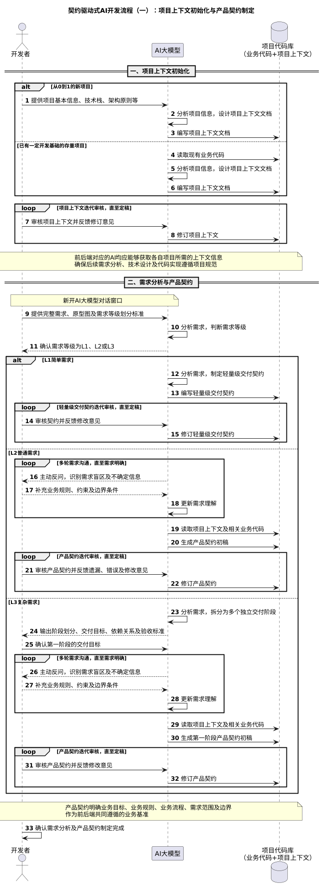
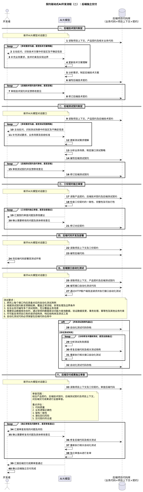
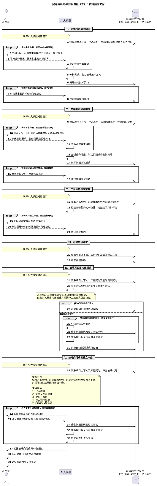

# 整体流程时序图

本文档以时序图形式展示契约驱动式 AI 开发各阶段的关键流程与参与方交互关系。

---

## 一、项目上下文初始化与产品契约制定

该阶段涵盖项目上下文初始化、需求沟通、需求等级判定及产品契约制定。

**阶段要点**：

- 新项目由开发者提供基本信息，AI 设计项目上下文；存量项目由 AI 分析现有代码后生成
- 项目上下文需经开发者审核迭代，直至定稿
- 需求输入应充分详细，AI 根据内容判定 L1/L2/L3 等级
- L1 需求生成轻量级交付契约；L2/L3 需求需经多轮反问沟通后生成产品契约
- L3 需求需拆分为多个独立交付阶段，逐阶段执行

---

## 二、后端独立交付

该阶段涵盖后端技术契约制定、后端测试契约制定、三份契约独立审查、后端代码开发、接口自动化测试及交付成果独立审查。

**阶段要点**：

- 技术契约与测试契约编写阶段均需给予 AI 充分的反问机会
- 三份契约完成后需组织独立审查，使用全新的 AI Agent 会话
- 代码开发严格遵循已定稿契约，发现契约问题时先反馈开发者确认
- 接口自动化测试原则上覆盖每个接口，测试代码保留在代码仓库中
- 交付成果由独立审查 AI 全面审查，形成问题发现→修复→回归测试→复审的闭环

---

## 三、前端独立交付

该阶段涵盖前端技术契约制定、前端测试契约制定、三份契约独立审查、前端代码开发、页面自动化测试及交付成果独立审查。

**阶段要点**：

- 前端技术契约需结合后端接口文档（如 Swagger）编写
- 前端测试契约以页面操作类测试用例为主，覆盖真实用户交互场景
- 页面自动化测试可通过浏览器自动化工具直接执行，或编写 Playwright 脚本保留为长期资产
- 前端交付成果独立审查重点关注代码质量、页面交互正确性、架构一致性及接口调用规范

---

## 四、整体验收与正式交付

前后端分别完成独立开发、自动化测试及交付后，进入整体验收阶段。

此阶段的核心目标是验证页面交互是否正常，以及完整业务流程是否符合产品契约要求。整体验收属于最终交付前的必要保障环节，必须由开发者按照前端测试契约中的测试用例，逐项进行人工实际操作，验证页面交互、业务流程及操作结果是否符合预期。

如果联调过程中发现问题，首先分析问题归属：

- 后端问题：由后端 AI 排查修复，重新执行接口及页面自动化测试
- 前端问题：由前端 AI 排查修复，重新执行页面自动化测试
- 契约问题：重新审视相关契约，开发者确认调整方案后修改实现

只有当接口自动化测试、页面自动化测试及真人实际操作测试均通过，才能认定本次需求满足正式交付条件，部署上线并将交付契约归档至对应代码仓库。
